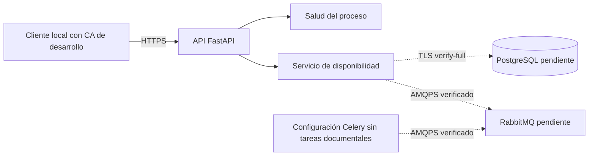

# Arquitectura actual

## Límite de F002

Un paquete Python contiene la API, configuración y adaptadores de disponibilidad.
La única ejecución comprobada es local en Windows con HTTPS. No existen tablas de
dominio, procesamiento de archivos ni servicios PostgreSQL/RabbitMQ provisionados.
La configuración Celery está preparada; el worker se ejecutará en Linux más adelante.

Las líneas discontinuas representan conexiones preparadas cuyo servicio real no
se verifica en F002. La respuesta de disponibilidad es 503 cuando faltan servicios;
no se simula un backend operativo para presentar un estado saludable.

## Responsabilidades

| Módulo | Responsabilidad |
| --- | --- |
| `__main__.py` | Validar arranque y construir el servidor Uvicorn con contexto TLS obligatorio. |
| `main.py` | Construir FastAPI e inyectar el servicio de disponibilidad. |
| `config.py` | Cargar variables, validar rutas/hosts/CA y leer credenciales con representación ocultada. |
| `api/` | Respuestas HTTP mínimas y rechazo de solicitudes sin esquema HTTPS. |
| `application/readiness.py` | Combinar comprobaciones y convertir fallos en estados sin exponer excepciones. |
| `infrastructure/` | Conexiones PostgreSQL/RabbitMQ y configuración TLS/Celery. |
| `scripts/bootstrap_local.py` | Crear o validar activos de desarrollo sin rotarlos ni cambiar confianza del sistema. |

No hay reglas de negocio documental todavía. Su ubicación se definirá junto a la
feature de ingestión y procesamiento, sin concentrarlas en rutas HTTP o `main.py`.

## Patrones utilizados

### Inyección de dependencias

Consiste en recibir colaboradores en lugar de crearlos obligatoriamente dentro de
cada operación. `create_app` admite un `ReadinessService`, que a su vez recibe dos
funciones de comprobación. Permite probar fallos sin instalar servidores y cambiar
un adaptador sin modificar las rutas.

La contrapartida es mantener explícito el montaje de dependencias. No se introduce
un contenedor de inyección adicional para estos pocos componentes.

### Adaptadores de infraestructura

`check_postgres` y `check_broker` encapsulan sus bibliotecas y reglas de TLS. El
servicio de disponibilidad trabaja con funciones sin conocer SQL, AMQP o passwords.
La separación reduce acoplamiento; las pruebas con dobles requieren complementarse
con integración real en la feature final.

### Fábrica de aplicación

`create_app` construye FastAPI después de validar configuración. Importar el módulo
no carga secretos ni abre conexiones. Facilita pruebas aisladas y evita servicios
conectados como efecto secundario de importar rutas.

No se implementan Repository Pattern, outbox o un framework de estados en esta
feature: todavía no existe una operación documental que los necesite.

## Límites de confianza y recuperación

La API solo escucha inicialmente en loopback y no acepta cabeceras proxy para
declarar HTTPS. El cliente comprueba CA y nombre; los adaptadores también verifican
el servidor de su dependencia. La clave privada de la API no es requisito del worker.

Los secretos y la CA privada quedan fuera de Git, dentro del almacenamiento que el
responsable declara cifrado. No se ha auditado el host. La PKI institucional,
respaldos y renovación necesitan diseño antes de datos reales.

Los resultados operativos futuros usarán estado persistente y auditoría. Un PDF
con fallo no implica que nunca haya empezado; puede dejar artefactos parciales que
no deben publicarse como metadatos completos. Retirarlo del reencolamiento conserva
el archivo, el motivo, el actor y el historial.
