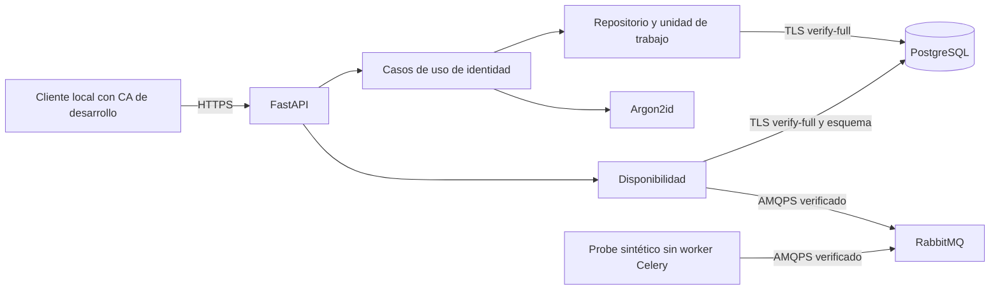

# Arquitectura actual

## Aplicación modular local

Un paquete Python contiene API, dominio, casos de uso y adaptadores. Se verificó
Windows con HTTPS, PostgreSQL nativo TLS y RabbitMQ AMQPS. La API y el futuro worker
son procesos separados; Docker y la ejecución Celery Linux siguen en la feature final.
F004A añade una interfaz React compilada, servida desde la misma API HTTPS.
Su revisión visual y HTTPS están verificados con la CA autorizada para Usuario.
No hay procesamiento documental.

## Responsabilidades

| Módulo | Responsabilidad |
| --- | --- |
| `__main__.py` | Arranque HTTPS Uvicorn sin cabeceras proxy de confianza. |
| `main.py`, `identity_runtime.py` | Fábrica/composición de API y casos de uso; importar no conecta servicios. |
| `config.py` | Ajustes centralizados, lectura literal de `.env`, validación y redacción de valores de entrada. |
| `api/` | Contratos HTTP, cookies, Origin/CSRF y errores genéricos. No decide concesiones ni transacciones. |
| `domain/identity/` | Registros, permisos, errores y reglas de identidad. |
| `application/identity/` | Login, sesiones, cuentas, autorización y auditoría; puertos independientes de HTTP/SQL. |
| `infrastructure/persistence/` | Conexión TLS, SQL parametrizado, repositorio y unidad de trabajo PostgreSQL. |
| `infrastructure/passwords.py` | Argon2id y límite de concurrencia de hash. |
| `identity_admin.py`, `backend/migrations/` | Aprovisionamiento explícito y migraciones versionadas; fuera del arranque API. |
| `application/readiness.py`, adaptadores de mensajería | Estado de dependencias y TLS/Celery, sin procesamiento documental. |
| `scripts/` | Activos de desarrollo, integración nativa TLS y comprobaciones reproducibles. |

## Patrones y garantías

La fábrica de aplicación admite servicios inyectados y no abre conexiones al
importar módulos. La composición construye colaboradores explícitos, sin contenedor
de inyección adicional. El repositorio encapsula psycopg y la unidad de trabajo
confirma cambios y auditoría juntos; un fallo revierte ambos. Los rechazos de acceso
se registran antes de propagar el error público.

Un bloqueo asesor transaccional serializa operaciones de identidad para impedir
carreras de revocación o desactivación del último superusuario. Es una elección
para administración local; medir contención antes de ampliar la carga. No se
introduce microservicio de identidad, outbox ni estados de documentos sin necesidad.

Las sesiones usan tokens aleatorios opacos; PostgreSQL solo almacena sus hashes.
El servidor revisa vigencia, usuario activo y permiso en cada acción. El catálogo
reserva acciones futuras; los filtros por fondo/reporte acompañarán a esos recursos.
[ADR 0005](decisions/0005-local-identity.md) detalla alternativas y costes.

## Límites de confianza y recuperación

API loopback y HTTPS obligatorio. PostgreSQL/RabbitMQ requieren CA, nombre y TLS;
la red interna futura no sustituirá estas garantías. La cuenta de servicio no es
propietaria de la base: la API no usa credenciales administrativas ni puede borrar
o alterar auditoría. El administrador propietario PostgreSQL conserva su autoridad.

Secretos en `.env` ignorado y claves TLS en archivos protegidos de `.local/`; la
identidad nativa PostgreSQL se copia con ACL limitada a ProgramData. La CA existente
se confió expresamente en Usuario CurrentUser\Root el 2026-11-13, sin alterar el
almacén de la máquina; el arranque no instala confianza. El responsable declara almacenamiento cifrado; esa declaración
no verifica host, futuros volúmenes ni respaldos. La PKI institucional y su renovación
siguen pendientes antes de datos reales.

Los resultados documentales futuros usarán historial persistente. Un fallo puede
dejar artefactos parciales sin publicarlos como metadatos completos. Retirar un
fallido del reencolamiento conservará PDF, causa, actor e historial; F003 no mueve
archivos ni implementa esos trabajos.

## Portal React F004A

React/TypeScript/Vite compila en `frontend/dist`. FastAPI sirve únicamente index y
assets públicos con huella, con CSP del mismo origen. Node no es un runtime del
servidor y el frontend no contiene secretos ni almacena identificadores de sesión.
[ADR 0007](decisions/0007-react-portal.md) registra la elección y sus límites.
