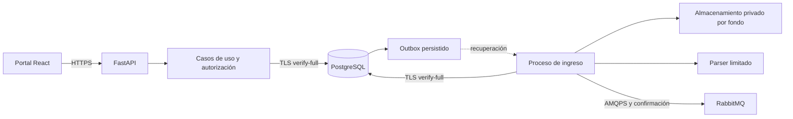

# Arquitectura actual

## Aplicación modular local

Un paquete Python contiene API, dominio, casos de uso y adaptadores. Windows ejecuta
FastAPI HTTPS, PostgreSQL nativo TLS y RabbitMQ AMQPS. React/TypeScript se compila y
sirve desde la API; no existe un servidor Node operativo ni otro backend web.
F004B añade un proceso independiente de ingreso/validación/publicación. El worker
Celery Linux y Docker continúan diferidos a la feature final. No hay OCR/metadatos.

## Responsabilidades

| Módulo | Responsabilidad |
| --- | --- |
| `__main__.py`, `main.py` | Componer y arrancar HTTPS sin proxy de confianza ni credenciales administrativas. |
| `identity_runtime.py`, `ingestion_runtime.py` | Composición de identidad/ingreso; CLI de operación y depósito. |
| `config.py` | Ajustes validados y `.env` literal con errores sin secretos. |
| `api/` | Contratos HTTP, cookies, Origin/CSRF y errores públicos; sin decisiones de negocio. |
| `domain/`, `application/` | Identidad, reglas, permisos/ámbitos, lotes y orquestación mediante puertos. |
| `infrastructure/persistence/` | SQL parametrizado, unidad de trabajo, TLS e historia persistente. |
| `infrastructure/storage/`, `pdf_probe.py` | Movimiento sin reemplazo, identidad/hash y parser en hijo limitado. |
| `infrastructure/messaging/` | AMQPS, probe y productor Celery JSON con confirmaciones. |
| `identity_admin.py`, migraciones | Aprovisionamiento explícito, fuera del arranque API. |
| `frontend/` | Interfaz, cliente HTTPS del mismo origen y compilación, sin secretos. |
| `scripts/` | Preparación e integración local reproducibles bajo Usuario. |

## Transacciones y autorización

La fábrica compone colaboradores explícitos y no conecta al importar módulos.
Sesiones opacas almacenadas como hashes, cookies Secure/HttpOnly/SameSite y CSRF.
Sesión, acción y ámbito se verifican con la mutación y auditoría en la misma unidad
de trabajo. Un bloqueo transaccional serializa revocaciones/administración y evita
actuar con permisos obsoletos. No se mantiene mientras se parsea o espera al broker.

El superusuario administra cuentas/fondos/concesiones. Una cuenta ordinaria combina
permiso y fondo; filtros e IDs se comprueban también ante HTTP directo. Auditoría
con fondo queda filtrada por alcance. El superusuario no recibe administración SQL/host.

El rol SQL runtime no crea esquemas/tablas ni altera historia. Documentos y claves de
fondos son inmutables para ese rol; eventos/auditoría permiten SELECT/INSERT. La
migración aditiva 0002 y grants se aplican explícitamente, sin DROP/reset automático.

## Archivos, ejecución y mensajes

Una raíz privada/volumen, carpetas por fondo y nombres internos UUID. `.part` no
participa en lotes. El depósito verifica y publica sin sobrescritura; el ingreso
registra intención antes de mover y reconcilia ubicación/identidad después de caídas.
Un código global único impide otra ingestión canónica; el omitido se conserva.

Cada lote captura candidatos. Pausar/detener dejan terminar la admisión iniciada;
la parada conserva pendientes para otro lote. Un bloqueo asesor separado impide
pasos simultáneos de dos procesos en la misma base. Cerrar el navegador no afecta
el procesamiento de comandos persistidos.

Validación estructural sin extracción/renderizado en hijo con límites de tamaño,
páginas, memoria/CPU y plazo propio; el padre mantiene además su timeout. Son límites
verificados, no certificación antimalware ni aislamiento del futuro despliegue.

Documento/intento/evento/outbox se guardan juntos; el sistema de archivos tiene su
propio registro recuperable. El productor confirma mensajes Celery v2 persistentes
con IDs/versiones, sin PDF, texto, prompts, secretos ni rutas absolutas. Un fallo
conserva publicación pendiente; una caída tras publicar puede repetir el mismo ID.
El futuro consumidor debe ser idempotente. `En cola` no es metadatos completos.

El productor puede declarar/bind/publicar únicamente en las entidades aprobadas;
no tiene read de la cola operativa. Pruebas aisladas usan ingestion_test y conservan
mensajes desconocidos. No se ejecuta un worker Celery Windows ni se purgan colas.

## Límites de confianza

API loopback por HTTPS, SQL verify-full y AMQPS con cadena/hostname. La red interna
no sustituye TLS. La CA de desarrollo existente está autorizada en Usuario
CurrentUser\Root, sin confianza de máquina; el arranque no instala ni renueva raíces.

Secretos en `.env` ignorado, claves en `.local` protegido y datos fuera de Git/build.
Los archivos nuevos pertenecen a Usuario. El responsable declara cifrado actual;
no es verificación técnica del host, respaldos o volúmenes Linux futuros.
PKI institucional/renovación, retención y despliegue final siguen pendientes.

[Ingreso UFM](ingestion-local.md), [identidad](identity-local.md),
[ADR 0006](decisions/0006-ingestion-operation-proposal.md) y
[ADR React](decisions/0007-react-portal.md) completan el detalle operativo.
